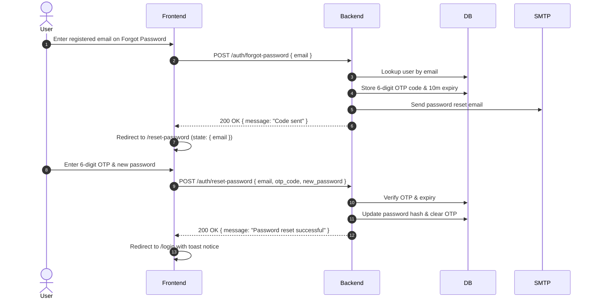

# End-to-End Production Authentication Flow & Architecture Guide

A battle-tested blueprint for full-stack authentication, designed to work reliably across modern browser constraints (Safari ITP, third-party cookies, cross-domain deployments such as Vercel + Render), mobile viewports, and multi-tab single-page applications (SPAs).

---

## 1. High-Level Architecture & Tech Stack

```
┌────────────────────────────────────────────────────────┐
│                   Frontend (React + Vite)              │
│  - Zustand Store (useAuthStore)                        │
│  - Axios Client (Interceptors for Bearer + Cookies)    │
│  - React Router v6 (Protected & Public Route Guards)   │
└─────────────────────────┬──────────────────────────────┘
                          │ HTTPS / JSON / Cookies
                          ▼
┌────────────────────────────────────────────────────────┐
│                  Backend API (FastAPI)                 │
│  - OAuth2 Password Bearer + Cookie Dual Auth Dependency│
│  - JWT Access Token (15m) & Refresh Token (7d)         │
│  - Passlib / Bcrypt Password Hashing                   │
│  - Transactional SMTP Email Service (6-digit OTPs)     │
└─────────────────────────┬──────────────────────────────┘
                          │
          ┌───────────────┴───────────────┐
          ▼                               ▼
┌──────────────────┐            ┌──────────────────┐
│  MySQL Database  │            │  Valkey / Redis  │
│  Users & Trades  │            │  Session & Cache │
└──────────────────┘            └──────────────────┘
```

---

## 2. Dual-Transport Token Strategy (Cross-Origin Resilience)

### The Problem
When frontend and backend are hosted on different domains (e.g., `frontend.vercel.app` and `api.onrender.com`), standard third-party cookie restrictions (Safari ITP, Chrome Privacy Sandbox, Incognito modes) often block cross-site cookies, causing silent `401 Unauthorized` errors or `Refresh token required` failures.

### The Solution: Dual-Transport Authentication
Every authentication endpoint sends and accepts tokens via **both**:
1. **HTTP-Only, Secure, SameSite=None Cookies** (primary for security against XSS).
2. **Authorization Bearer Header + LocalStorage Backup** (fallback for cross-domain environments where cookies are blocked).

### Backend Implementation (`backend/app/api/deps.py`)
```python
async def get_current_user(
    request: Request,
    token: Optional[str] = Depends(oauth2_scheme), # Checks Authorization: Bearer <token>
    db: Session = Depends(get_db)
) -> User:
    # 1. First preference: Authorization Bearer header
    # 2. Fallback: HTTP-only cookie
    jwt_token = token or request.cookies.get("access_token")
    if not jwt_token:
        raise HTTPException(status_code=401, detail="Not authenticated")
    
    payload = verify_jwt_token(jwt_token)
    user = db.query(User).filter(User.id == payload.get("sub")).first()
    if not user:
        raise HTTPException(status_code=401, detail="User not found")
    if not user.is_verified:
        raise HTTPException(status_code=403, detail="Please verify your email first.")
    return user
```

### Backend Cookie Setting (`backend/app/api/v1/auth.py`)
```python
def set_auth_cookies(response: Response, access_token: str, refresh_token: str):
    response.set_cookie(
        key="access_token",
        value=access_token,
        httponly=True,
        secure=True,          # Required for SameSite=None
        samesite="none",      # Allows cross-domain cookie transmission
        max_age=15 * 60       # 15 minutes
    )
    response.set_cookie(
        key="refresh_token",
        value=refresh_token,
        httponly=True,
        secure=True,
        samesite="none",
        max_age=7 * 24 * 3600 # 7 days
    )
```

### Frontend Axios Client (`frontend/src/api/client.js`)
```javascript
import axios from "axios";

const client = axios.create({
  baseURL: import.meta.env.VITE_API_URL || "https://api.yourdomain.com/api/v1",
  withCredentials: true, // Sends cross-origin cookies
});

// Request Interceptor: Attach Bearer token from localStorage
client.interceptors.request.use((config) => {
  const token = localStorage.getItem("access_token");
  if (token) {
    config.headers.Authorization = `Bearer ${token}`;
  }
  return config;
});

// Response Interceptor: Auto-refresh access token on 401
let isRefreshing = false;
let failedQueue = [];

const processQueue = (error, token = null) => {
  failedQueue.forEach((prom) => {
    if (error) prom.reject(error);
    else prom.resolve(token);
  });
  failedQueue = [];
};

client.interceptors.response.use(
  (response) => response,
  async (error) => {
    const originalRequest = error.config;

    // Avoid infinite refresh loops on auth endpoints
    if (
      error.response?.status === 401 &&
      !originalRequest._retry &&
      !originalRequest.url.includes("/auth/login") &&
      !originalRequest.url.includes("/auth/refresh") &&
      !originalRequest.url.includes("/auth/me")
    ) {
      if (isRefreshing) {
        return new Promise((resolve, reject) => {
          failedQueue.push({ resolve, reject });
        }).then((token) => {
          originalRequest.headers.Authorization = `Bearer ${token}`;
          return client(originalRequest);
        });
      }

      originalRequest._retry = true;
      isRefreshing = true;

      try {
        const storedRefreshToken = localStorage.getItem("refresh_token");
        const res = await client.post("/auth/refresh", {
          refresh_token: storedRefreshToken, // Send both in body and via cookie
        });

        const { access_token, refresh_token: newRefreshToken } = res.data;
        if (access_token) localStorage.setItem("access_token", access_token);
        if (newRefreshToken) localStorage.setItem("refresh_token", newRefreshToken);

        processQueue(null, access_token);
        originalRequest.headers.Authorization = `Bearer ${access_token}`;
        return client(originalRequest);
      } catch (refreshErr) {
        processQueue(refreshErr, null);
        localStorage.removeItem("access_token");
        localStorage.removeItem("refresh_token");
        window.location.href = "/login";
        return Promise.reject(refreshErr);
      } finally {
        isRefreshing = false;
      }
    }
    return Promise.reject(error);
  }
);

export default client;
```

---

## 3. User Registration & Unverified Collision Handling

### The Problem
If a user registers, but doesn't receive the OTP or closes the browser before verifying, their record remains in the database with `is_verified = False`. When they try to sign up again with the same email, naive systems return an error: `"Email already registered"`, leaving the user permanently locked out.

### The Solution: Graceful Unverified Collision
If an unverified user registers again:
1. Update their existing record with the new details (e.g. updated password hash, name).
2. Generate and store a fresh 6-digit OTP code with a 5-minute expiry.
3. Resend the OTP email and seamlessly guide them to the verification step.

```python
# backend/app/api/v1/auth.py
existing_user = db.query(User).filter(User.email == email).first()

if existing_user:
    if existing_user.is_verified:
        raise HTTPException(
            status_code=400,
            detail="An account with this email already exists. Please log in."
        )
    # Unverified user retrying: update password and send fresh OTP
    existing_user.first_name = data.first_name
    existing_user.last_name = data.last_name
    existing_user.password_hash = get_password_hash(data.password)
    user = existing_user
else:
    user = User(...)
    db.add(user)

db.commit()
send_verification_otp(user.email, db)
```

---

## 4. History Stack Management & Navigation Guards

### 1. Eliminating Auth Pages from History on Success (`replace: true`)
When navigating after a successful login or OTP verification, **always** use `{ replace: true }`:

```javascript
// frontend/src/pages/Login.jsx
await login(email, password);
toast.success("Successfully logged in!");
navigate("/dashboard", { replace: true }); // Overwrite /login in browser history stack
```

**Why**: If `replace: false` (the default) is used, `/login` remains in the back history. When the user later swipes back on mobile, the browser will attempt to navigate to `/login`.

---

### 2. Guarding Public Auth Screens Against Authenticated Users
A logged-in user should **never** see the Login, Register, Forgot Password, or Reset Password pages. If they navigate to one (via browser history or bookmarks), they must be redirected immediately:

```javascript
// Included in Login.jsx, Register.jsx, ForgotPassword.jsx, ResetPassword.jsx
const { user } = useAuthStore();
const navigate = useNavigate();

useEffect(() => {
  if (user) {
    navigate("/dashboard", { replace: true });
  }
}, [user, navigate]);
```

---

### 3. Protected Route Component (`frontend/src/components/ProtectedRoute.jsx`)
Ensures unauthenticated users cannot access dashboard routes while smoothly handling initial session restoration on page reload:

```javascript
import React from "react";
import { Navigate } from "react-router-dom";
import { useAuthStore } from "../store/useAuthStore";

const ProtectedRoute = ({ children }) => {
  const { user, loading } = useAuthStore();

  if (loading) {
    return (
      <div className="min-h-screen flex items-center justify-center bg-neutral-950 text-white">
        <div className="flex flex-col items-center space-y-4">
          <div className="animate-spin rounded-full h-12 w-12 border-t-2 border-b-2 border-violet-500" />
          <p className="text-neutral-400 font-medium">Restoring Session...</p>
        </div>
      </div>
    );
  }

  if (!user) {
    return <Navigate to="/login" replace />;
  }

  return children;
};

export default ProtectedRoute;
```

---

## 5. Mobile Viewport & Back Gesture Navigation

### 1. Viewport Fitting (`h-[100dvh]`)
Mobile browsers dynamically expand and contract their top address bar and bottom toolbar on scroll. Standard `100vh` calculates viewport height *excluding* these bars, which causes unwanted vertical scrollbars.

**Rule**: Always use `h-[100dvh] min-h-[100dvh]` on root auth containers:

```html
<div className="h-[100dvh] min-h-[100dvh] w-full overflow-hidden bg-white grid grid-cols-1 md:grid-cols-2">
  <div className="flex flex-col justify-between items-center py-2.5 sm:py-6 px-4 h-full min-h-0 overflow-y-auto [scrollbar-width:none]">
    <!-- Centered content with my-auto -->
    <div className="w-full max-w-md flex flex-col items-center my-auto">
      ...
    </div>
  </div>
</div>
```

---

### 2. Tab Navigation Synced to Browser History
In single-page app dashboards with internal tabs (e.g. Dashboard, Trades, History, Settings):
- If tabs are managed solely with `useState("Dashboard")`, swiping back on mobile will pop the entire `/dashboard` page and exit the app.
- **Solution**: Sync the active tab with React Router search parameters (`useSearchParams`):

```javascript
// frontend/src/pages/Dashboard.jsx
const VALID_TABS = ["Dashboard", "Trades", "History", "Calendar", "AICoach", "DailyNotes", "Profile & Settings"];

const Dashboard = () => {
  const [searchParams, setSearchParams] = useSearchParams();
  const currentTab = searchParams.get("tab");
  const activeTab = VALID_TABS.includes(currentTab) ? currentTab : "Dashboard";

  const setActiveTab = (tab) => {
    if (tab === activeTab) return;
    if (tab === "Dashboard") {
      setSearchParams({}, { replace: false });
    } else {
      setSearchParams({ tab }, { replace: false });
    }
  };

  // Close mobile navigation drawer if open when user triggers back gesture
  useEffect(() => {
    const handlePopState = () => setIsMobileSidebarOpen(false);
    window.addEventListener("popstate", handlePopState);
    return () => window.removeEventListener("popstate", handlePopState);
  }, []);
```

**Result**:
- Tapping through tabs creates discrete history records: `/dashboard` → `/dashboard?tab=Trades` → `/dashboard?tab=History`.
- Mobile back gestures step backward **one tab at a time** rather than exiting the application.

---

## 6. Password Recovery Lifecycle



---

## 7. Developer & Tester UX: Demo Credentials Banner

For portfolio projects and client demos hosted on cloud free-tiers (e.g., Render, Railway, Neon, Supabase):
- Cold starts can take 15–40 seconds on the first request.
- Testers often abandon signup when transactional emails are delayed or restricted.
- **Solution**: Add an Auto-Fill Demo Credentials card on Login & Register:

```jsx
<div className="w-full bg-amber-50/90 border border-amber-200/90 rounded-xl p-2.5 sm:p-3 mb-2.5 sm:mb-4 text-xs text-amber-950 shadow-sm">
  <div className="flex items-center justify-between gap-2 mb-1.5">
    <div className="flex items-center gap-1.5 font-bold text-[11px] text-amber-900">
      <span className="inline-block w-2 h-2 rounded-full bg-amber-500 animate-pulse" />
      Demo Credentials
    </div>
    <button
      type="button"
      onClick={() => {
        setEmail("demo@gmail.com");
        setPassword("Demo@123");
        toast.success("Demo credentials loaded!");
      }}
      className="text-[10px] font-bold text-violet-700 bg-violet-100 hover:bg-violet-200 px-2 py-0.5 rounded transition-colors"
    >
      Auto Fill
    </button>
  </div>
  <div className="text-[11px] flex flex-wrap gap-x-3 gap-y-0.5 text-amber-900 font-mono">
    <span><strong>Email:</strong> demo@gmail.com</span>
    <span><strong>Pass:</strong> Demo@123</span>
  </div>
  <p className="text-[10px] text-amber-800/90 mt-1 leading-snug">
    Note: Database is on a free tier and may require initial time to wake up.
  </p>
</div>
```

---

## 8. Summary Checklist for Any New Project

When replicating this authentication system in a new codebase, ensure:

- [ ] **Dual Transport**: Send tokens as both HTTP-only cookies (`SameSite=None; Secure=True`) and JSON response bodies stored in `localStorage` + attached as `Authorization: Bearer`.
- [ ] **Axios Interceptor Queue**: Implement request queuing during token refresh to avoid race conditions when multiple queries fail simultaneously on expiration.
- [ ] **Navigation Stack Replacement**: Always use `navigate("/dashboard", { replace: true })` on authentication success.
- [ ] **Public Route Auth Guards**: Check `if (user) navigate("/dashboard", { replace: true })` inside all public auth pages (`Login`, `Register`, `ForgotPassword`, `ResetPassword`).
- [ ] **Unverified Collision**: If `is_verified == False` upon duplicate registration, update credentials and resend a fresh OTP instead of throwing an unhandled duplicate email error.
- [ ] **Mobile Viewport**: Use `h-[100dvh] min-h-[100dvh]` to prevent mobile scrollbars from browser toolbars.
- [ ] **Tab History Sync**: Map internal dashboard tabs to `?tab=Name` query params so mobile gestures step back through tabs naturally.
- [ ] **Cold-Start UX**: Inform users about free-tier cloud database spin-up delays and provide 1-click demo login buttons.

