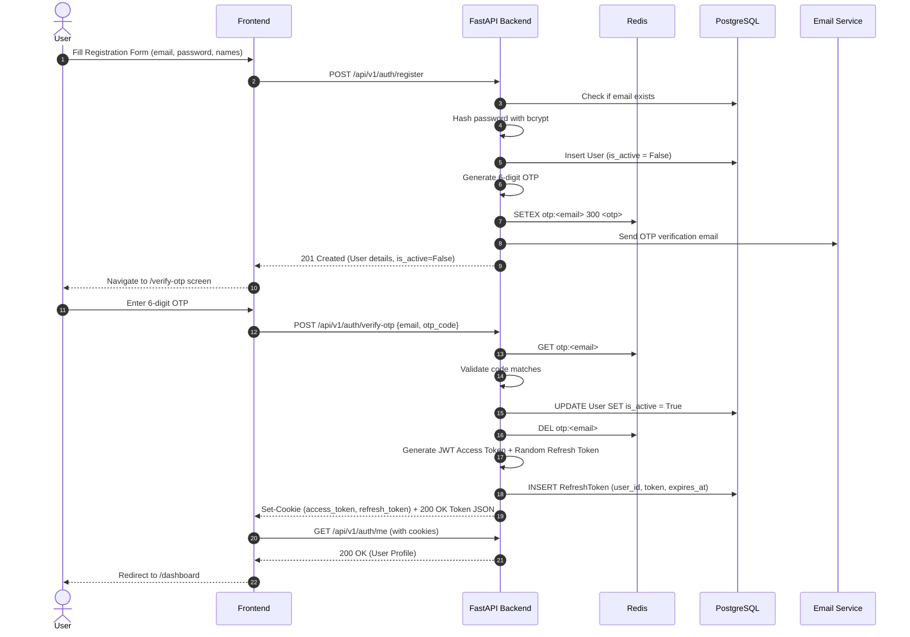
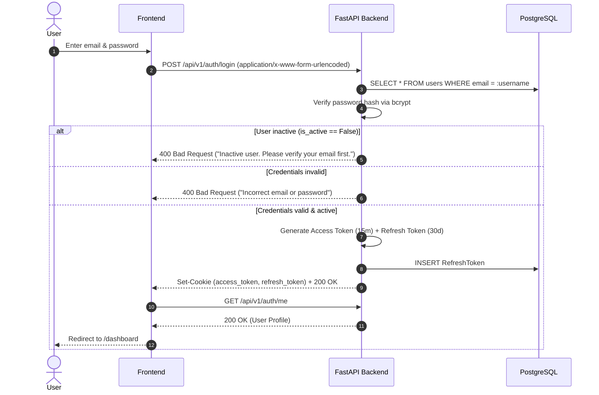
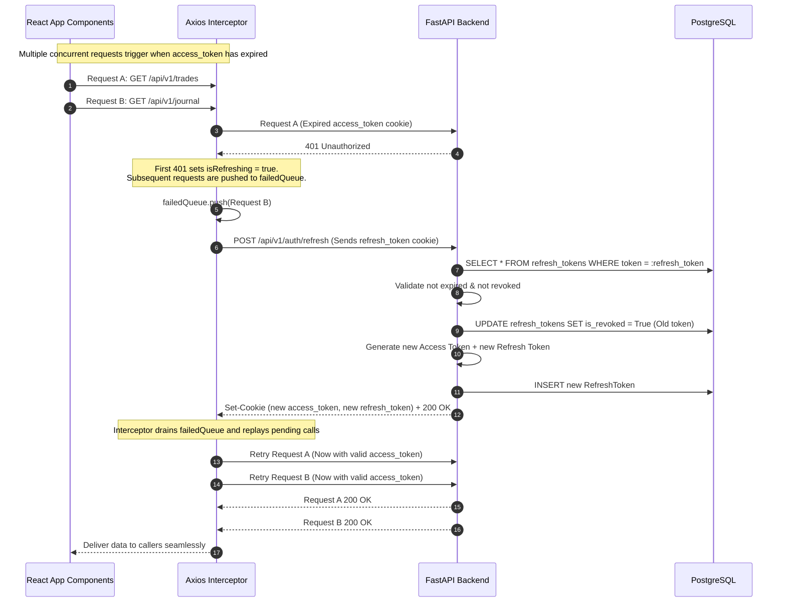
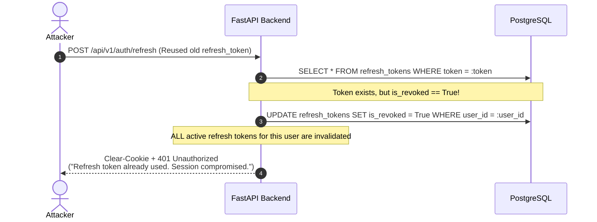
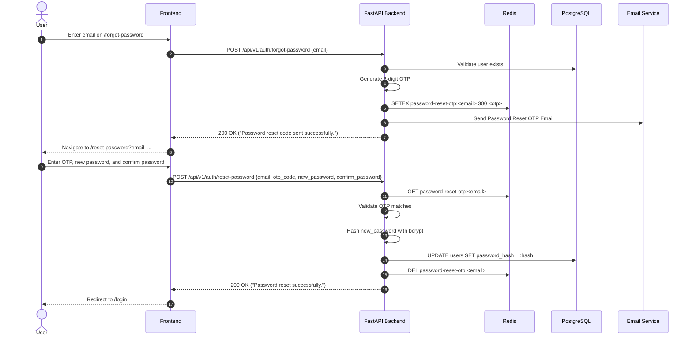
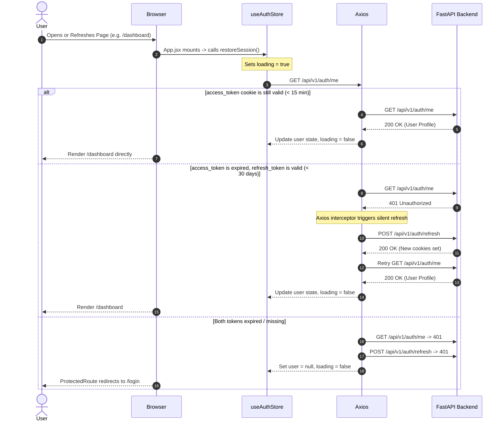

# Authentication Architecture & Flow Reference

This document provides a comprehensive, production-grade reference of the authentication and authorization system implemented in this project (**QuantCoach AI / Trading Journal**). It is structured specifically for developers and AI agents to understand, maintain, debug, and replicate the system across services.

---

## 1. High-Level Architecture & Strategy

The application implements a **defense-in-depth, hybrid token architecture**:
- **Dual-Token System**: Short-lived stateless JWT access tokens paired with long-lived stateful refresh tokens.
- **Transport Mechanism**: Primary delivery via secure **HTTP-only, SameSite=Lax cookies** for web browsers, with fallback support for `Authorization: Bearer <token>` and JSON bodies for mobile/external API clients and Swagger UI.
- **Token Rotation & Anti-Theft**: Every refresh request revokes the old refresh token and issues a new one. Attempted reuse of an already-revoked refresh token triggers an immediate **mass revocation** of all active sessions for that user.
- **Out-of-Band Email OTP Verification**: New registrations and password reset requests require 6-digit numeric OTPs verified via Redis caching (5-minute TTL) and transactional SMTP emails.

### Token Specifications

| Token Type | Lifespan | Format / Algorithm | Storage Location | Purpose |
| :--- | :--- | :--- | :--- | :--- |
| **Access Token** | 15 Minutes | Signed JWT (`HS256`), Subject: `user.email` | HTTP-only Cookie (`access_token`) or Header | Stateless API authorization per request |
| **Refresh Token** | 30 Days | Cryptographically random string (`secrets.token_urlsafe(32)`) | HTTP-only Cookie (`refresh_token`) + PostgreSQL | Stateful session continuation & token renewal |
| **OTP Code** | 5 Minutes (300s) | 6-digit integer string (`100000`–`999999`) | Redis (`otp:<email>` or `password-reset-otp:<email>`) | Email ownership verification & password recovery |

### Cookie Configuration Matrix

Both `access_token` and `refresh_token` cookies are configured via `set_auth_cookies`:
- `httponly`: `True` (Prevents client-side JavaScript access / XSS token exfiltration)
- `samesite`: `"lax"` (Protects against CSRF while allowing top-level navigation)
- `secure`: `False` in development (`True` in production HTTPS)
- `path`: `"/"`
- `max_age`: 900 seconds (15 min) for access token, 2,592,000 seconds (30 days) for refresh token

---

## 2. Data Models & Storage Schema

### 2.1 Relational Database (PostgreSQL / SQLAlchemy)

#### `users` Table
- `id` (`VARCHAR(36)`, UUID PK): Primary user identifier.
- `email` (`VARCHAR(255)`, Unique, Indexed): User email / login username.
- `first_name` (`VARCHAR(100)`): User first name.
- `middle_name` (`VARCHAR(100)`, Nullable): Optional middle name.
- `last_name` (`VARCHAR(100)`, Nullable): Optional last name.
- `password_hash` (`VARCHAR(255)`): Bcrypt password hash generated with unique salt.
- `is_active` (`BOOLEAN`, Default: `False` on register, `True` after OTP verification): Controls account access.
- `created_at` (`TIMESTAMP`): Account creation timestamp.
- Address fields: `address_line1`, `city`, `state`, `country`, `postal_code`.

#### `refresh_tokens` Table
- `id` (`VARCHAR(36)`, UUID PK): Primary key.
- `user_id` (`VARCHAR(36)`, FK `users.id` ON DELETE CASCADE): Session owner.
- `token` (`VARCHAR(255)`, Unique, Indexed): 32-byte URL-safe random string.
- `expires_at` (`TIMESTAMP`): Expiration datetime (30 days from creation).
- `is_revoked` (`BOOLEAN`, Default: `False`): Revocation flag for rotation and logout.
- `created_at` (`TIMESTAMP`): Issuance timestamp.

### 2.2 In-Memory Cache (Redis)

| Key Pattern | Value Type | TTL | Purpose |
| :--- | :--- | :--- | :--- |
| `otp:<email>` | String (6 digits) | 300 seconds (5 min) | Account registration verification OTP |
| `password-reset-otp:<email>` | String (6 digits) | 300 seconds (5 min) | Password reset verification OTP |

---

## 3. Core Authentication Workflows

### 3.1 Registration & Verification Flow



---

### 3.2 Login Flow



---

### 3.3 Silent Token Refresh (Rotation) & Request Queueing

When the 15-minute access token expires, client API requests receive HTTP 401. The frontend Axios interceptor automatically coordinates silent refresh without user disruption:



---

### 3.4 Token Theft Detection & Mass Revocation

If an attacker steals a previously used refresh token and attempts to replay it:



---

### 3.5 Password Reset Flow



---

### 3.6 Session Restoration on Page Reload



---

## 4. Complete API Endpoint Specification

All authentication routes are prefixed with `/api/v1/auth`.

### 1. Register User
- **Method & Route**: `POST /api/v1/auth/register`
- **Request Body**:
  ```json
  {
    "email": "trader@example.com",
    "first_name": "John",
    "middle_name": "M",        // Optional
    "last_name": "Doe",         // Optional
    "password": "Password123",  // Min 8 chars, 1 digit, 1 upper, 1 lower
    "confirm_password": "Password123"
  }
  ```
- **Responses**:
  - `201 Created`: Returns user object (`is_active: false`). OTP dispatched via email.
  - `400 Bad Request`: Email already exists, password validation failed, or passwords do not match.

### 2. Verify Registration OTP
- **Method & Route**: `POST /api/v1/auth/verify-otp`
- **Request Body**:
  ```json
  {
    "email": "trader@example.com",
    "otp_code": "482910"
  }
  ```
- **Behavior**: Activates account (`is_active = True`), clears Redis OTP, creates refresh token in DB, sets HTTP-only cookies.
- **Responses**:
  - `200 OK`: Sets cookies + returns:
    ```json
    {
      "access_token": "<jwt>",
      "refresh_token": "<token_val>",
      "token_type": "bearer"
    }
    ```
  - `400 Bad Request`: Code expired, invalid, or user already verified.
  - `404 Not Found`: User does not exist.

### 3. Resend Registration OTP
- **Method & Route**: `POST /api/v1/auth/resend-otp`
- **Request Body**:
  ```json
  {
    "email": "trader@example.com"
  }
  ```
- **Responses**:
  - `200 OK`: `{"message": "Verification code resent successfully."}`
  - `400 Bad Request`: Email is already verified.
  - `404 Not Found`: User does not exist.

### 4. Login (OAuth2 Compatible)
- **Method & Route**: `POST /api/v1/auth/login`
- **Content-Type**: `application/x-www-form-urlencoded`
- **Body Form Data**:
  - `username`: `trader@example.com`
  - `password`: `Password123`
- **Responses**:
  - `200 OK`: Sets cookies + returns token JSON.
  - `400 Bad Request`: Incorrect email/password, or `Inactive user. Please verify your email first.`

### 5. Refresh Access Token (Token Rotation)
- **Method & Route**: `POST /api/v1/auth/refresh`
- **Cookies**: `refresh_token` (HTTP-only)
- **Fallback Body**: `{"refresh_token": "<string>"}` (Optional if cookie is absent)
- **Behavior**:
  - Rotates refresh token (marks previous token as revoked, inserts new one).
  - Employs token theft detection: if an already-revoked token is received, revokes all tokens for that user session.
- **Responses**:
  - `200 OK`: Updates both cookies (`access_token`, `refresh_token`) + returns token JSON.
  - `401 Unauthorized`: Token expired, invalid, or reuse detected.

### 6. Logout
- **Method & Route**: `POST /api/v1/auth/logout`
- **Behavior**: Marks the active refresh token `is_revoked = True` in DB, clears `access_token` and `refresh_token` cookies.
- **Responses**:
  - `200 OK`: `{"message": "Successfully logged out."}`

### 7. Get Current User Profile
- **Method & Route**: `GET /api/v1/auth/me`
- **Authentication**: `access_token` cookie or `Authorization: Bearer <token>`
- **Responses**:
  - `200 OK`: Returns current user object (`id`, `email`, `first_name`, `last_name`, address fields, `is_active`, `created_at`).
  - `401 Unauthorized`: Missing or invalid credentials.

### 8. Update User Profile
- **Method & Route**: `PUT /api/v1/auth/profile`
- **Authentication**: Required (`get_current_user`)
- **Request Body**:
  ```json
  {
    "first_name": "John",
    "middle_name": "A",
    "last_name": "Smith",
    "address_line1": "123 Wall St",
    "city": "New York",
    "state": "NY",
    "country": "USA",
    "postal_code": "10005"
  }
  ```
- **Responses**:
  - `200 OK`: Updated user profile.

### 9. Forgot Password (Request OTP)
- **Method & Route**: `POST /api/v1/auth/forgot-password`
- **Request Body**:
  ```json
  {
    "email": "trader@example.com"
  }
  ```
- **Responses**:
  - `200 OK`: `{"message": "Password reset code sent successfully."}` (OTP cached in Redis under `password-reset-otp:<email>` with 300s TTL).
  - `404 Not Found`: The user with this email does not exist.

### 10. Reset Password (Verify OTP & Change Password)
- **Method & Route**: `POST /api/v1/auth/reset-password`
- **Request Body**:
  ```json
  {
    "email": "trader@example.com",
    "otp_code": "819203",
    "new_password": "NewSecurePassword1",
    "confirm_password": "NewSecurePassword1"
  }
  ```
- **Responses**:
  - `200 OK`: `{"message": "Password reset successfully. Please log in with your new password."}`
  - `400 Bad Request`: Expired or incorrect code, password format mismatch.
  - `404 Not Found`: User not found.

### 11. Test Expire Cookie (Development Utility)
- **Method & Route**: `POST /api/v1/auth/test-expire`
- **Behavior**: Clears the `access_token` cookie to artificially simulate token expiration and test automatic interceptor recovery.

---

## 5. Client-Side Implementation Patterns

### 5.1 Axios Client & Refresh Interceptor (`frontend/src/api/client.js`)

Key architectural rules implemented:
1. `withCredentials: true` is strictly required on all requests to pass cookies across origins.
2. An in-flight refresh request lock (`isRefreshing`) prevents duplicate `/auth/refresh` API calls when multiple requests fail simultaneously.
3. Requests arriving while a refresh is in flight are held in a `failedQueue` and retried once the new access token is established.
4. If `/auth/refresh` fails, a global `window.dispatchEvent(new Event("auth_logout"))` clears the client Zustand store, forcing a clean redirect to `/login`.

```javascript
import axios from "axios";

const API_URL = import.meta.env.VITE_API_URL || "/api/v1";

const client = axios.create({
  baseURL: API_URL,
  withCredentials: true,
  headers: { "Content-Type": "application/json" },
});

let isRefreshing = false;
let failedQueue = [];

const processQueue = (error) => {
  failedQueue.forEach((prom) => {
    if (error) prom.reject(error);
    else prom.resolve();
  });
  failedQueue = [];
};

client.interceptors.response.use(
  (response) => response,
  async (error) => {
    const originalRequest = error.config;

    if (error.response?.status === 401 && !originalRequest._retry) {
      if (isRefreshing) {
        return new Promise((resolve, reject) => {
          failedQueue.push({ resolve, reject });
        })
          .then(() => client(originalRequest))
          .catch((err) => Promise.reject(err));
      }

      originalRequest._retry = true;
      isRefreshing = true;

      try {
        await axios.post(`${API_URL}/auth/refresh`, {}, { withCredentials: true });
        processQueue(null);
        isRefreshing = false;
        return client(originalRequest);
      } catch (refreshError) {
        processQueue(refreshError);
        isRefreshing = false;
        window.dispatchEvent(new Event("auth_logout"));
        return Promise.reject(refreshError);
      }
    }

    return Promise.reject(error);
  }
);

export default client;
```

### 5.2 Zustand Auth Store (`frontend/src/store/useAuthStore.js`)

Manages client authentication state, session bootstrapping, and reacts to global auth events:

```javascript
import { create } from "zustand";
import client from "../api/client";

export const useAuthStore = create((set) => ({
  user: null,
  loading: true,

  restoreSession: async () => {
    set({ loading: true });
    try {
      const response = await client.get("/auth/me");
      set({ user: response.data, loading: false });
    } catch (error) {
      set({ user: null, loading: false });
    }
  },

  login: async (email, password) => {
    const params = new URLSearchParams();
    params.append("username", email);
    params.append("password", password);

    await client.post("/auth/login", params, {
      headers: { "Content-Type": "application/x-www-form-urlencoded" },
    });
    const userResponse = await client.get("/auth/me");
    set({ user: userResponse.data });
    return userResponse.data;
  },

  logout: async () => {
    try {
      await client.post("/auth/logout");
    } catch (error) {
      console.error(error);
    }
    set({ user: null });
  },

  clearAuth: () => set({ user: null }),
}));

if (typeof window !== "undefined") {
  window.addEventListener("auth_logout", () => {
    useAuthStore.getState().clearAuth();
  });
}
```

### 5.3 Protected Route Guard (`frontend/src/components/ProtectedRoute.jsx`)

Prevents unauthorized users from seeing protected screens while avoiding jarring redirect flickers during initial session resolution:
- While `loading === true`: Renders a dark loading spinner.
- If `!user`: Redirects to `/login` via `<Navigate to="/login" replace />`.
- If `user` is valid: Renders protected child components.

---

## 6. Critical Security & Configuration Rules

1. **CORS Configuration**:
   - `allow_credentials=True` **must** be set on the FastAPI `CORSMiddleware`.
   - `allow_origins` must never contain wildcard `["*"]` when credentials are enabled. It must explicitly specify the frontend origin (e.g., `["http://localhost:5173"]`).
2. **Environment Variables**:
   - `JWT_SECRET_KEY`: Must be a long, randomly generated secret in production.
   - `ACCESS_TOKEN_EXPIRE_MINUTES`: Default `15`.
   - `REFRESH_TOKEN_EXPIRE_DAYS`: Default `30`.
   - `REDIS_HOST` & `REDIS_PORT`: Must point to the active Redis instance for OTP caching.
   - `EMAILS_ENABLED`: If `False`, OTPs are logged to the backend console for local development. If `True`, real emails are dispatched via SMTP.
3. **Cookie Secure Flag in Production**:
   - In production deployments running HTTPS, update `secure=True` in `set_auth_cookies` (`backend/app/api/v1/auth.py`) to restrict cookie transmission to TLS connections only.

---

## 7. File Map & Code Locations

| Component | File Path |
| :--- | :--- |
| **Auth Router & Endpoints** | [backend/app/api/v1/auth.py](file:///d:/WEB%20DEV/Trading_Journal/backend/app/api/v1/auth.py) |
| **Auth Dependencies & JWT Extractor** | [backend/app/api/deps.py](file:///d:/WEB%20DEV/Trading_Journal/backend/app/api/deps.py) |
| **Password Hashing & JWT Core** | [backend/app/core/security.py](file:///d:/WEB%20DEV/Trading_Journal/backend/app/core/security.py) |
| **User & RefreshToken Models** | [backend/app/models/user.py](file:///d:/WEB%20DEV/Trading_Journal/backend/app/models/user.py) |
| **Auth Request/Response Schemas** | [backend/app/schemas/user.py](file:///d:/WEB%20DEV/Trading_Journal/backend/app/schemas/user.py) |
| **Email Service & SMTP Templates** | [backend/app/services/email.py](file:///d:/WEB%20DEV/Trading_Journal/backend/app/services/email.py) |
| **Configuration Settings** | [backend/app/config.py](file:///d:/WEB%20DEV/Trading_Journal/backend/app/config.py) |
| **Axios Client & 401 Rotation Interceptor** | [frontend/src/api/client.js](file:///d:/WEB%20DEV/Trading_Journal/frontend/src/api/client.js) |
| **Zustand Auth Store** | [frontend/src/store/useAuthStore.js](file:///d:/WEB%20DEV/Trading_Journal/frontend/src/store/useAuthStore.js) |
| **Route Guard** | [frontend/src/components/ProtectedRoute.jsx](file:///d:/WEB%20DEV/Trading_Journal/frontend/src/components/ProtectedRoute.jsx) |
| **App Shell & Lifecycle Mount** | [frontend/src/App.jsx](file:///d:/WEB%20DEV/Trading_Journal/frontend/src/App.jsx) |
